# Database relationships (ER diagram)

Generated from `backend/server/drizzle/meta/0017_snapshot.json` — every line below is a real foreign key.

Line legend: `||--o{` = one parent, many children. The label is `column (ON DELETE rule)`.

```mermaid
erDiagram
  Conversation ||--o{ ConversationParticipant : "conversationId (no action)"
  Conversation ||--o{ DirectConversation : "conversationId (no action)"
  Conversation ||--o{ Group : "conversationId (no action)"
  Conversation ||--o{ MediaAsset : "conversationId (no action)"
  Conversation ||--o{ Message : "conversationId (no action)"
  Conversation ||--o{ Notification : "conversationId (cascade)"
  Group ||--o{ GroupMember : "groupId (cascade)"
  Language ||--o{ Group : "languageId (no action)"
  Language ||--o{ LanguageCertificate : "languageId (no action)"
  Language ||--o{ UserLanguage : "languageId (no action)"
  Message ||--o{ Conversation : "lastMessageId (set null)"
  Message ||--o{ MessageCorrection : "messageId (cascade)"
  Message ||--o{ MessageTranslation : "messageId (cascade)"
  Message ||--o{ Report : "messageId (set null)"
  Message ||--o{ SavedPhrase : "messageId (set null)"
  RefreshToken ||--o{ RefreshToken : "replacedById (set null)"
  User ||--o{ Block : "blockedId (no action)"
  User ||--o{ Block : "blockerId (no action)"
  User ||--o{ ConversationParticipant : "userId (no action)"
  User ||--o{ DirectConversation : "userHighId (no action)"
  User ||--o{ DirectConversation : "userLowId (no action)"
  User ||--o{ Follow : "followeeId (cascade)"
  User ||--o{ Follow : "followerId (cascade)"
  User ||--o{ Group : "ownerId (no action)"
  User ||--o{ GroupMember : "userId (cascade)"
  User ||--o{ LanguageCertificate : "userId (cascade)"
  User ||--o{ MediaAsset : "ownerId (cascade)"
  User ||--o{ Message : "senderId (no action)"
  User ||--o{ MessageCorrection : "authorId (no action)"
  User ||--o{ Notification : "actorId (cascade)"
  User ||--o{ Notification : "userId (cascade)"
  User ||--o{ PasswordResetToken : "userId (cascade)"
  User ||--o{ Profile : "userId (no action)"
  User ||--o{ PushToken : "userId (cascade)"
  User ||--o{ Reference : "authorId (cascade)"
  User ||--o{ Reference : "subjectId (cascade)"
  User ||--o{ RefreshToken : "userId (cascade)"
  User ||--o{ Report : "reportedId (no action)"
  User ||--o{ Report : "reporterId (no action)"
  User ||--o{ SavedPhrase : "userId (cascade)"
  User ||--o{ UserLanguage : "userId (no action)"
  User ||--o{ UserSettings : "userId (cascade)"
```

Tables without a foreign key to another table: Language, User.

Deliberately not foreign keys: `Message.clientMessageId` (client idempotency key), `RefreshToken.familyId` (groups a rotation chain; no family table).
